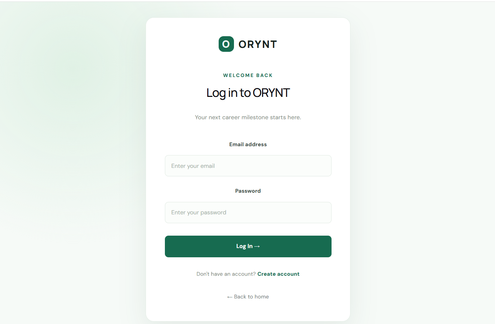
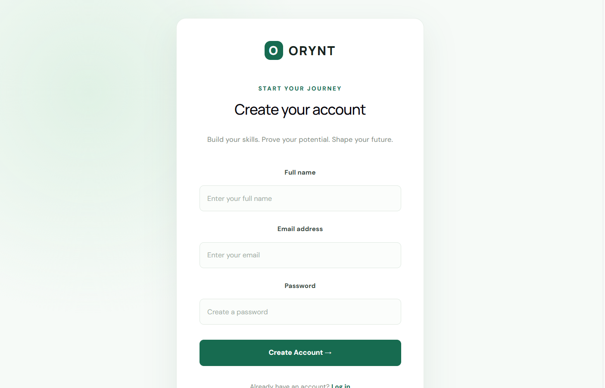
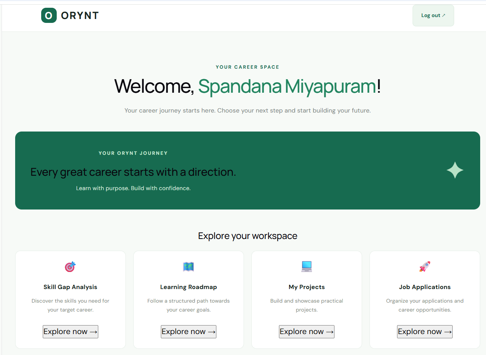
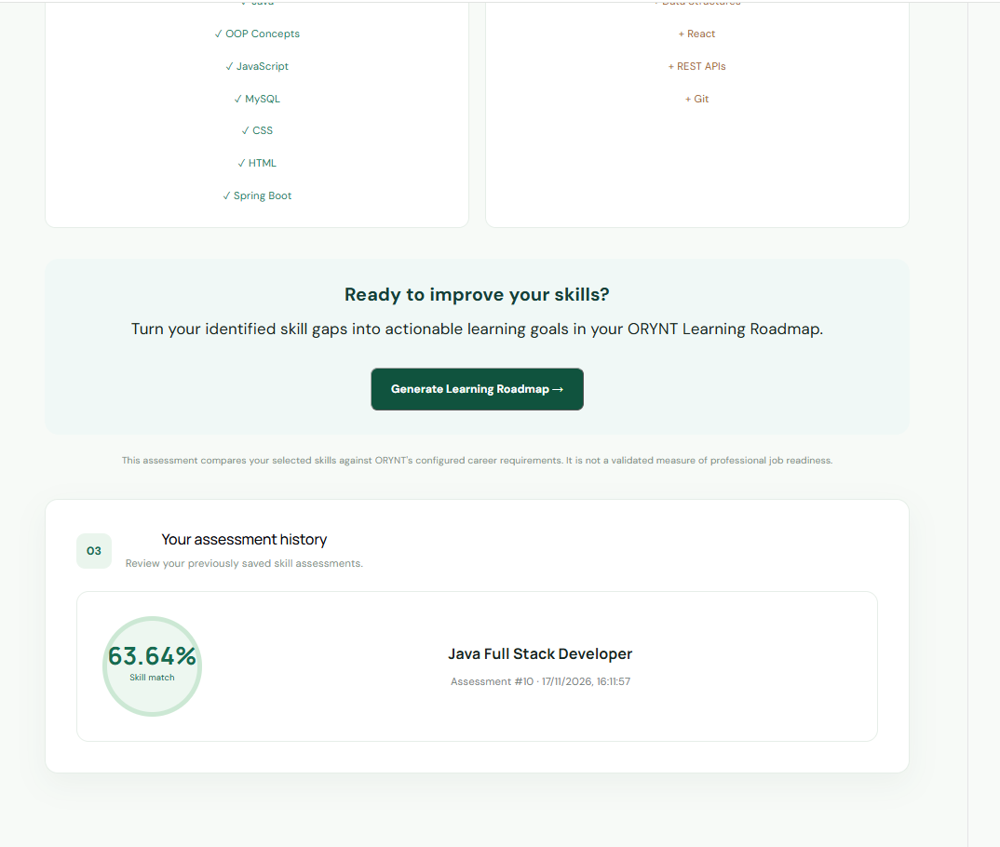
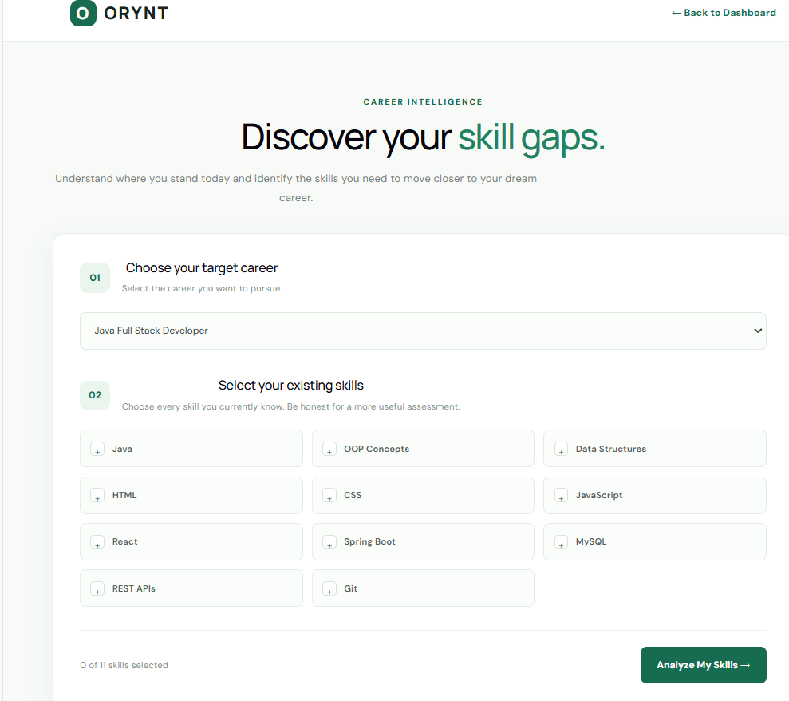
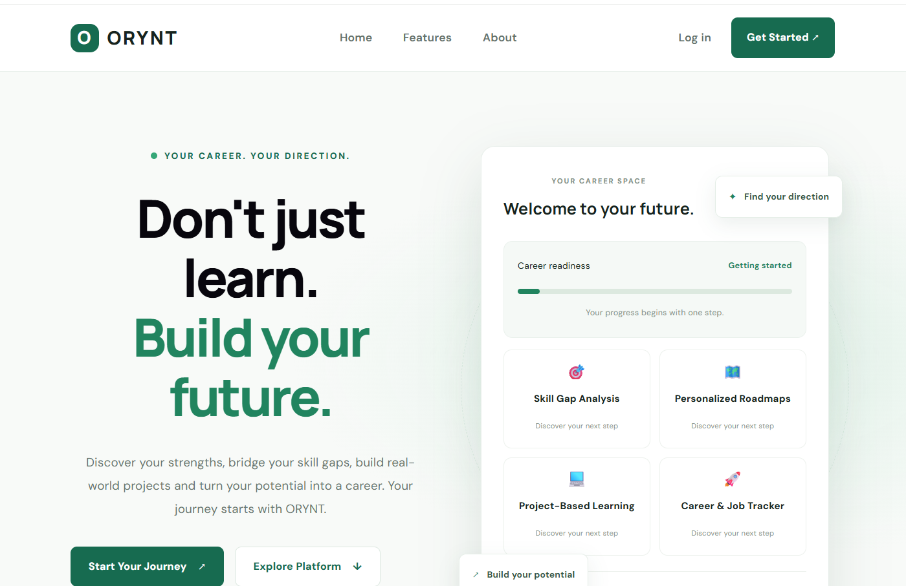
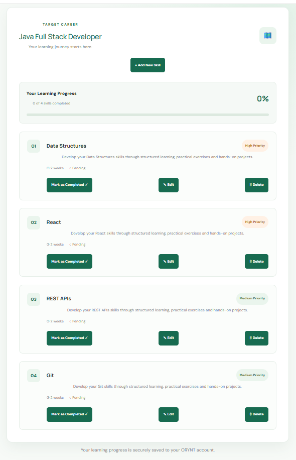
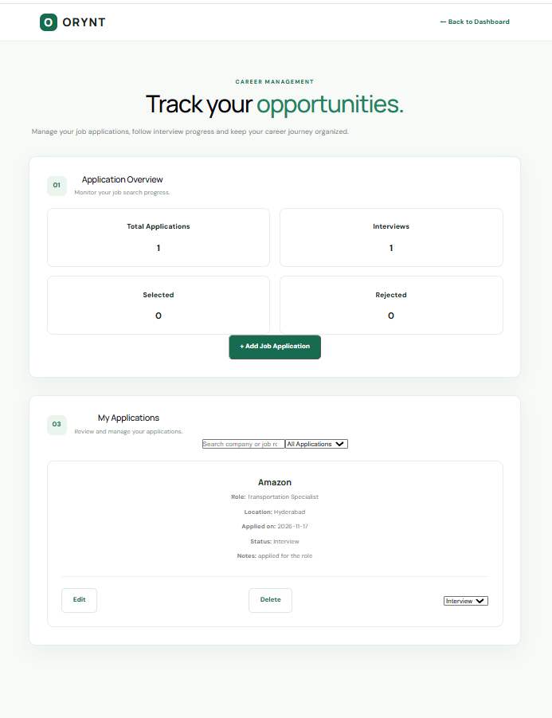
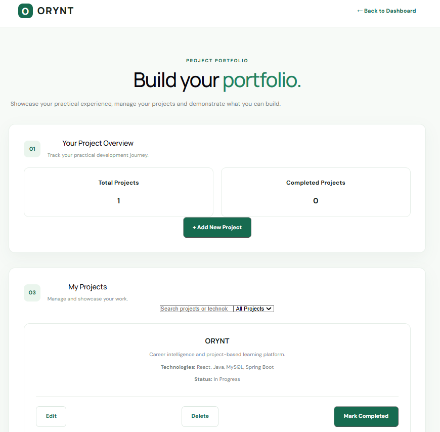

ORYNT – Career Intelligence & Project-Based Learning Platform

Prove Your Skills. Build Your Future.

About ORYNT

ORYNT is a career intelligence and project-based learning platform designed to help aspiring developers understand their skill levels, identify learning gaps, and follow structured learning roadmaps.

The platform aims to bridge the gap between theoretical learning and practical industry requirements by encouraging skill development through structured learning and practical projects.

Key Features

- User Authentication: Secure user registration and login using JWT authentication.
- Skill Assessment: Evaluate technical skills through a structured assessment system.
- Skill Gap Analysis: Identify areas that require improvement.
- Learning Roadmaps: Organize learning goals into structured roadmaps.
- Progress Tracking: Track roadmap completion and learning progress.

Technology Stack

Frontend

- React.js
- JavaScript
- HTML5
- CSS3

Backend

- Java
- Spring Boot
- Spring Data JPA
- Spring Security
- JWT Authentication

Database

- MySQL

Development Tools

- Visual Studio Code
- MySQL Workbench
- Postman
- Git and GitHub
- Maven

Project Structure

ORYNT/
├── orynt-frontend/
├── src/
│   ├── main/
│   │   ├── java/
│   │   └── resources/
│   └── test/
├── pom.xml
├── mvnw
├── mvnw.cmd
└── README.md

Project Objective

To help aspiring developers move beyond traditional learning by providing a structured approach to skill assessment, learning roadmaps, and practical development.

Project Status

Developed as part of an internship project.

---

ORYNT – Prove Your Skills. Build Your Future.
---

## Application Screenshots

### 1. Login Page

### 2. Registration Page

### 3. Dashboard

### 4. Skill Assessment

### 5. Skill Gap Analysis

### 6. Learning Roadmap

### 7. Learning Progress

### 8. My Applications

### 9. My Projects
